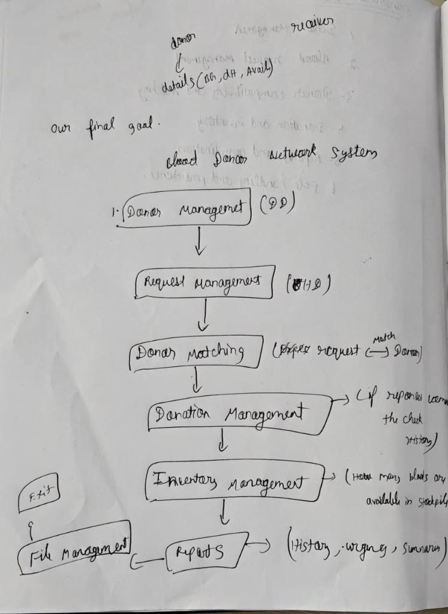
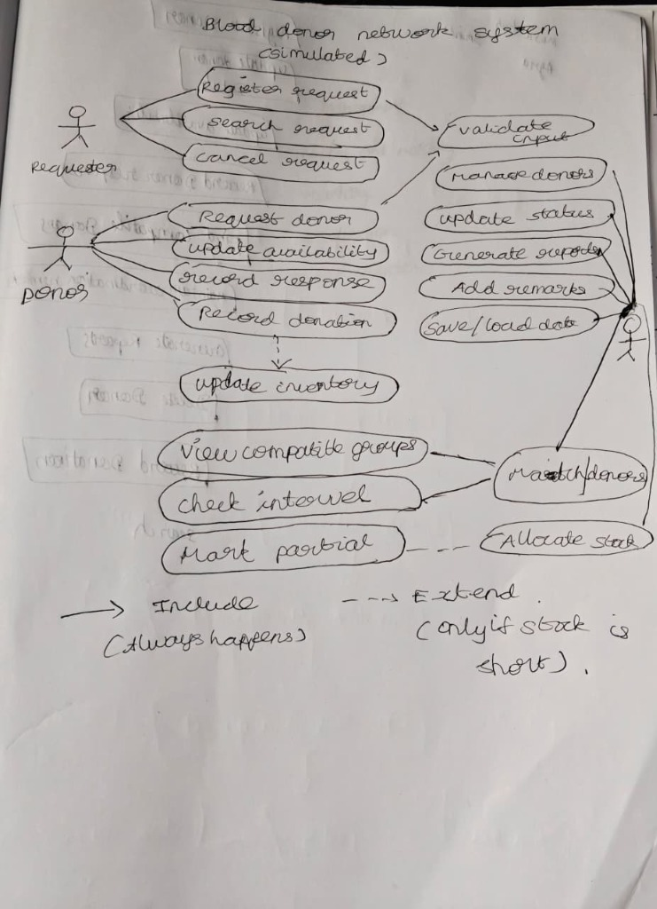

# Blood Donor Network & Emergency Request Coordination System

A C++ based simulation system for managing blood donors, handling emergency blood requests, matching compatible donors, managing blood inventory stockpiles, and generating coordination reports.

---

## 📌 System Design & Architecture

### 1. System Flow & Module Breakdown
The system is divided into core operational modules:

1. **Donor Management:** Register donors, maintain donor details (Blood Group, Contact Details, Availability).
2. **Request Management:** Handle emergency and standard blood requests.
3. **Donor Matching:** Match patient/recipient blood group requests with compatible registered donors.
4. **Donation Management:** Record responses from donors and verify donation eligibility/interval history.
5. **Inventory Management:** Monitor and update available blood units in the stockpile.
6. **Reports:** Generate history logs, urgent request summaries, and inventory reports.
7. **File Management:** Save and load persistent data to/from disk.

---

### 2. Use Case Diagram

The use case diagram illustrates the interactions between the system actors (**Requester**, **Donor**, and **Admin / System Staff**):

- **Requester:**
  - Register request
  - Search request
  - Cancel request
- **Donor:**
  - Update availability status
  - Record response
  - Record donation & update inventory
- **Admin / System:**
  - Validate input
  - Manage donors
  - Update request status
  - Match donors (`<<include>>` View compatible blood groups, Check donation interval)
  - Allocate stock (`<<extend>>` Mark partial fulfillment if stock is short)
  - Generate reports & add remarks
  - Save and load system data

